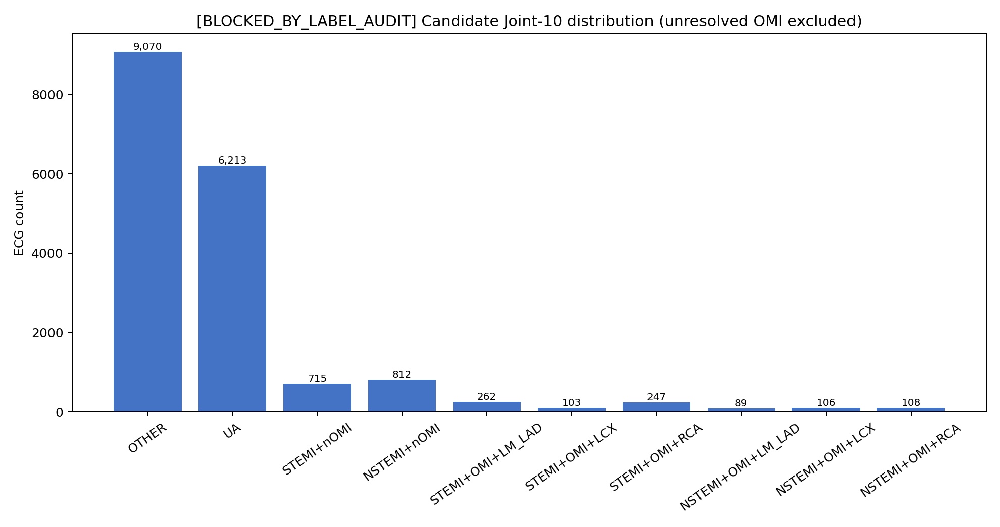
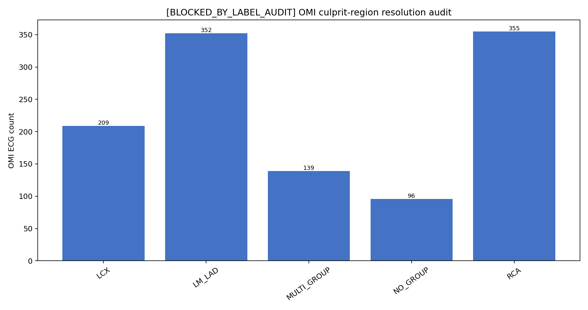

# ECG-LFM Nature-style Joint-10 交叉验证比较报告

**审计日期：** 2026-09-04

**执行状态：** `BLOCKED_BY_LABEL_AUDIT`

**最终结论：** `NO-GO（标签可行性门槛）`

**本轮 GPU 训练：** 未启动

**外部测试集：** 未访问

> 本报告以当前仓库、服务器端真实标签 CSV、冻结的 nested patient-level folds、配置、checkpoint 和结果文件为证据。新执行报告明确要求：若 OMI 病例不能获得可靠且唯一的 LM/LAD、LCX 或 RCA 责任血管标签，必须停止，不得猜测、删除病例或改变 folds。真实审计发现 1,151 条 OMI 中有 235 条无法唯一归组，因此执行在模型实现和训练之前终止。

## 1. Repository Audit

| 模块 | 真实路径 | 关键实现 | 当前真实行为 | 本轮处理 |
|---|---|---|---|---|
| 权威 W0 配置 | `configs/ecg_lfm/corrected_joint_lora.yaml` | Hydra config | ECG-LFM + LoRA，逻辑上为 ACS 四分类与独立 OMI 二分类 | 未修改 |
| 训练入口 | `experiments/ecg_lfm/run_joint_fold.py` | fold runner、provenance | 加载冻结 manifest、预训练权重，调用原 Fairseq runner | 未修改 |
| 数据任务 | `third_party/ECG-LFM/fairseq_signals/tasks/ecg_classification.py` | `ECGDiagnosisTask` | 从 manifest 和标签数组读取样本 | 未修改 |
| 模型 | `third_party/ECG-LFM/fairseq_signals/models/classification/ecg_transformer_classifier.py` | `ECGTransformerClassificationModel` | pooled 1024-D 后接一个物理 `Linear(1024,5)`；前 4 logits 为 ACS，末 1 logit 为 OMI | 未新增 Joint-10 分支 |
| LoRA | 同模型文件及 `modules/parameter_efficient.py` | `inject_linear_adapters` | rank=8、alpha=16、dropout=0.05；冻结 backbone，训练 LoRA 与 head | 未修改 |
| W0 Loss | `third_party/ECG-LFM/fairseq_signals/criterions/acs_joint.py` | `ACSJointCriterion.forward` | `CE(logits[:,:4]) + BCEWithLogits(logits[:,4])` | 未修改 |
| Nested split | `experiments/ecg_lfm/build_nested_manifests.py` | `build_fold` | 固定 outer 5 folds；outer-train 内用 patient-level `StratifiedGroupKFold` 建 inner split | 未重划 |
| W0 evaluator | `experiments/ecg_lfm/evaluate_nested_fold.py` | `prediction_rows`、`metric_bundle` | 通过 `record_id` 显式对齐；inner-validation 选 OMI 阈值，冻结后评价 outer-test | 未修改 |
| Joint-10 标签审计 | `experiments/ecg_lfm/audit_joint10_labels.py` | `resolve_culprit_group`、`candidate_joint10` | 只把字段值 1 当作急性证据；值 2 只作为 CTO；跨大血管多阳性不猜测 | 本轮新增 |
| 审计图 | `experiments/ecg_lfm/render_joint10_label_audit.py` | aggregate-only renderer | 只读取聚合统计，不读取波形或输出患者表 | 本轮新增 |

扫描范围还包括 `data/CSV/train.csv`、`data/CSV/test.csv`、`manifests/ecg_lfm_nested/fold0..4`、W0/LoRA/DoRA checkpoint、训练日志、revalidated 结果及历史报告。训练服务器目录不是 Git checkout，而是 Windows 工作区的 SFTP 镜像；本地审计基准提交为 `9bc80f21effee887a33c2f2fe9920e4f818c337d`。

### 与新执行报告预期的差异

1. W0 在任务语义上确实是 two-head objective，但物理实现不是两个独立 `Linear` 层，而是一个 `Linear(1024,5)` 后按 `[0:4]` 与 `[4]` 切分。
2. 当前 corrected nested W0 并未完成 5 折：Fold0 完成训练与严格 nested 评价；Fold1/Fold3 有 checkpoint，但 launch provenance 没有正常完成标记；Fold2/Fold4 缺失。历史 `corrected_ecg_lfm_joint_bs64_v2/lora` 有完整 5-fold，但属于较早的非 nested pooled OOF 流程，不能冒充本轮 Baseline-Rerun。
3. 当前配置相对历史 W0 配置增加了显式 `task.formulation: factorized_two_head`；训练语义没有改变，但文件 SHA 从历史记录的 `20d630...` 变为当前 `a8a5b8...`，因此不能声称旧结果与未来 rerun 是字节级相同配置。
4. 当前数据没有单一 `culprit_vessel` / `infarct_related_artery` 字段；只有分段病变编码。Nature Communications 方法的数据来源具有明确判定的 culprit artery，而本项目公开表格无法为所有 OMI 唯一恢复该变量。
5. 本执行报告指定的 OTHER/UA/STEMI/NSTEMI Joint-10 是“借鉴论文 joint-outcome 思想的项目自定义标签空间”，并非逐类复刻论文原始十类标签；本报告统一称其为 Nature-style，而不声称 canonical reproduction。

## 2. Authoritative Baseline Identification

当前权威工程基线为：

```text
12-lead ECG @ 500 Hz
  -> ECG-LFM pretrained encoder
  -> LoRA (r=8, alpha=16, dropout=0.05)
  -> mean pooled 1024-D representation
  -> Linear(1024, 5)
       logits[0:4]: OTHER/STEMI/NSTEMI/UA, softmax + CE
       logits[4]:   OMI/NOMI, sigmoid + BCEWithLogits
  -> total loss = ACS CE + 1.0 * OMI BCE
```

权重配置为 `acs_weight=null`、`omi_pos_weight=null`、`omi_loss_weight=1.0`。优化器为 Adam，LR=`1e-4`，betas=`(0.9,0.98)`，eps=`1e-8`；step scheduler，warmup=0，min LR=`1e-12`，decay period=112，decay=0.99；batch=64，gradient accumulation=4，有效 batch=256；FP16；最多 100 epochs；patience=10；以 inner-validation 总 loss 最小保存 checkpoint。

## 3. Original Cross-Validation Protocol

当前 corrected authoritative protocol 为 patient-level nested 5-fold：

1. 沿用 `manifests/ecg_lfm/fold0..4` 的原 outer patient folds；
2. 每个 outer-train 内使用 `StratifiedGroupKFold(n_splits=5, shuffle=True, random_state=2026)`；
3. 分层目标为 8-state `ACS class × OMI`，group 为 `patient_id`；
4. 固定使用第一个 inner split；
5. inner-validation 用于 early stopping、checkpoint、calibration 和 OMI threshold；
6. outer-test 只进行一次最终评价，不参与模型选择。

## 4. CV Fingerprint

五折均已做只读指纹验证：fold 数=5，seed=2026，三个子集的 patient overlap=0。每折 `record_ids_sha256`、`patient_ids_sha256`、assignment 文件 SHA 和 canonical assignment SHA 见 [`cv_fingerprint.csv`](../results/joint10_label_audit/cv_fingerprint.csv)。本轮没有生成任何新 split，也没有移动、删除或交换患者。

## 5. Real Label Audit

训练标签池共有 17,960 条 ECG、17,018 名患者。真实标签交叉核对覆盖：

- `train.csv` 的 record/patient/ACS/OMI；
- `master_records.csv` 的 index、record 和 patient；
- `y_all.npy` 的 STEMI/NSTEMI/UA/OMI。

不一致数为 0。原始 OMI 为 1,151 条 ECG、1,139 名患者；`UA+OMI=0`；`OTHER+OMI=1`（1 名患者）。该 OTHER+OMI 原始标签未删除、未篡改。额外核对原始 `AMI` 字段发现 2 条 `AMI=1` 记录没有 STEMI/NSTEMI subtype（其中 1 条为 OTHER+OMI），反向的 STEMI/NSTEMI 但 `AMI=0` 为 0；见 [`ami_subtype_audit.csv`](../results/joint10_label_audit/ami_subtype_audit.csv)。这两条也是 Joint-10 临床语义需数据方确认的例外。

## 6. Coronary Location Field Audit

真实字段及分组：

- LM/LAD：`LM, PLAD, MLAD, DLAD, DB`
- LCX：`PLCX, MLCX, DLCX, OM`
- RCA：`PRCA, MRCA, DRCA`

所有字段只出现 `0/1/2`。依据数据集正式数据字典，1 表示 OMI 病例中的急性闭塞性病变，2 表示 CTO；因此 acute mapping 严格使用 `field == 1`，禁止 `field > 0`。完整频数见 [`coronary_field_values.csv`](../results/joint10_label_audit/coronary_field_values.csv)，字段定义见 [`raw_coronary_fields.csv`](../results/joint10_label_audit/raw_coronary_fields.csv)。

CTO 审计：全队列 `CTO=1` 有 957 条，而任一冠脉分段字段值为 2 有 1,116 条；OMI 中 `CTO=1` 为 0，但 116 条 OMI 含至少一个值 2 的分段，26 条同时含急性值 1 和 CTO 值 2。该差异进一步说明不能把所有非零冠脉字段等同于 acute culprit。

## 7. Joint-10 Label Construction

执行报告指定的候选 class order 保存在 [`joint10_mapping_rules.json`](../results/joint10_label_audit/joint10_mapping_rules.json)：

| ID | Joint-10 class | ECG | 患者 |
|---:|---|---:|---:|
| 0 | OTHER | 9,070 | 8,936 |
| 1 | UA | 6,213 | 5,812 |
| 2 | STEMI+nOMI | 715 | 713 |
| 3 | NSTEMI+nOMI | 812 | 803 |
| 4 | STEMI+OMI+LM/LAD | 262 | 262 |
| 5 | STEMI+OMI+LCX | 103 | 103 |
| 6 | STEMI+OMI+RCA | 247 | 246 |
| 7 | NSTEMI+OMI+LM/LAD | 89 | 89 |
| 8 | NSTEMI+OMI+LCX | 106 | 106 |
| 9 | NSTEMI+OMI+RCA | 108 | 108 |

以上只是**候选映射统计**，不是可训练标签集。它只覆盖 17,725 条记录，另有 235 条 OMI 无法映射。把这些病例删除会改变研究队列和 OMI 分布，违反执行报告。



## 8. Culprit-Vessel Resolution Audit

对标准 STEMI/NSTEMI OMI 病例：

| 解析状态 | ECG | 解释 |
|---|---:|---|
| 唯一 LM/LAD、LCX 或 RCA | 915 | 可生成候选 Joint-10 标签 |
| `NO_GROUP` | 96 | 没有任何分段字段值为 1 |
| `MULTI_GROUP` | 139 | 至少两个大血管组同时含值 1 |
| 未解析合计 | 235 | 占全部 OMI 20.42% |

若把 OTHER+OMI singleton 也列入位置描述，则唯一位置统计为 LM/LAD=352、LCX=209、RCA=355；其中 LM/LAD 的 352 包含该 1 条 OTHER+OMI，标准 ACS OMI 可用于 Joint-10 的唯一病例数仍是 915。

跨组组合为：LM/LAD+RCA 50、LCX+RCA 43、LM/LAD+LCX 32、三组同时阳性 14。数据目录及 parser 中没有独立 culprit-vessel 字段可以消解这 139 条多组记录，也无法为 96 条无 acute group 记录补标签。



Nature Communications 论文使用明确判定的 OMI culprit artery；本数据集只有分段病变状态。二者的信息条件并不等价，不能仅凭模型结构相似就推断标签可直接迁移。参考：[Nature Communications 论文](https://www.nature.com/articles/s41467-026-73023-1)、[官方代码](https://github.com/stefan-gustafsson-work/omi)、[当前数据集论文/数据字典](https://www.nature.com/articles/s41597-026-07278-0)。

## 9. Baseline Reproduction

**本轮 Baseline-Rerun 未启动。** 原因不是 GPU 或代码错误，而是执行顺序在 Step 6 的 Joint-10 label-space 可行性门槛终止。没有可训练的 J10 时重跑完整 B0 不能形成报告规定的公平 B0-vs-J10 比较，还会消耗约 5 折训练资源。

仅为背景、不得当作本轮重跑结果：

| 证据层级 | ACS Macro AUPRC | ACS Macro AUROC | ACS Macro F1 | OMI AUPRC | OMI AUROC | OMI Sens. | NSTEMI-vs-UA AUPRC | NSTE OMI AUPRC |
|---|---:|---:|---:|---:|---:|---:|---:|---:|
| 历史 non-nested 5-fold pooled OOF LoRA | 0.538971 | 0.787046 | 0.510257 | 0.431529 | 0.910630 | 0.854909 | 0.553431 | 0.278766 |
| 既有 corrected nested W0 Fold0 inner-validation（非本轮重跑） | 0.558565 | 0.798900 | 0.531178 | 0.466715 | 0.918460 | 0.891192 | 0.560098 | 0.310952 |
| 既有 corrected nested W0 Fold0 outer-test（非本轮重跑） | 0.546685 | 0.783155 | 0.525076 | 0.412660 | 0.897364 | 0.831169 | 0.526039 | 0.227752 |

OMI Sensitivity 均为各自已有 Youden operating point；历史 pooled OOF threshold=0.05，nested Fold0 threshold 由 inner-validation 冻结为 0.04。inner-validation 不是泛化测试结果，不能与 outer-test 或 pooled OOF 混用。

## 10. Joint-10 Implementation

**未实现。** 新报告要求 Step 6 先确认每个 OMI 能可靠构造唯一责任血管标签；真实审计失败。故没有新增 Joint-10 head、criterion、config、checkpoint 或 prediction exporter。此前未提交的 Joint-6 修改已撤销，正在运行的 Joint-6 会话已停止；其残留 partial checkpoint/log 仅保留在服务器作为历史执行痕迹，不作为结果、不进入 Git。

## 11. Training Configuration Comparison

| 项目 | B0 | J10 |
|---|---|---|
| 当前配置定义 | `corrected_joint_lora.yaml` | 未创建 |
| 当前配置 SHA256 | `a8a5b847...` | N/A |
| 历史 W0 provenance config SHA256 | `20d6304f...` | N/A |
| 差异来源 | 当前配置显式注册 `factorized_two_head` | 标签门槛未通过 |
| 是否训练 | 否 | 否 |

因此本轮不能输出 `NO CONFIG DIFFERENCE`，也不能宣称 baseline reproduction 成功。

## 12. Cross-Validation Results

没有本轮 B0/J10 交叉验证指标。原 folds 的 Joint-10 候选 support 已完整统计，见 [`joint10_counts_by_fold.csv`](../results/joint10_label_audit/joint10_counts_by_fold.csv)。每个 inner-train 中十个候选类均非零，但每折也都有大量未解析 OMI；support 非零并不能消除标签缺失问题。

| 子集 | Fold0 未解析 | Fold1 未解析 | Fold2 未解析 | Fold3 未解析 | Fold4 未解析 |
|---|---:|---:|---:|---:|---:|
| inner-train | 147 | 145 | 149 | 142 | 147 |
| inner-validation | 44 | 45 | 36 | 43 | 42 |
| outer-test | 44 | 45 | 50 | 50 | 46 |

## 13. ACS Results

J10 未训练，故 ACS Macro AUROC/AUPRC/F1、Balanced Accuracy、Accuracy 和逐类指标均为 N/A。不得用候选标签分布或历史 W0 指标填充 J10 结果。

## 14. OMI Results

J10 未训练，故 OMI AUROC/AUPRC/F1/Sensitivity/Specificity/PPV/NPV/MCC/Accuracy 及混淆矩阵均为 N/A。

## 15. NSTE-ACS Analysis

J10 未训练，故 NSTEMI-vs-UA 和 OMI among NSTE-ACS 的新模型结果均为 N/A。

## 16. Culprit-Vessel Localization

没有训练分类器，因此 culprit-vessel Macro AUPRC/AUROC/F1 与逐血管性能均为 N/A。当前只能说明数据中可解析候选支持度：标准 OMI 的 LM/LAD=351、LCX=209、RCA=355；最小候选组为 LCX，但“哪一类模型最难”不能在无预测时判断。

## 17. Calibration

J10 未训练，无 joint logits，故不能生成温度缩放、Brier、ECE 或 calibration curve。任何校准数值都将是虚构结果。

## 18. Fold-wise Stability

无 J10 fold-wise 性能，不能评价稳定性或计算 mean±std/95% CI。已验证的只有原 split 完整性和候选类/未解析病例在五折中的支持度。

## 19. Baseline vs Joint-10 Paired Comparison

| Model | ACS Macro AUPRC | ACS Macro AUROC | NSTEMI-vs-UA AUPRC | OMI AUPRC | OMI AUROC | OMI Sens. | NSTE OMI AUPRC | Culprit Macro AUPRC |
|---|---:|---:|---:|---:|---:|---:|---:|---:|
| Original baseline rerun | N/A（未运行） | N/A | N/A | N/A | N/A | N/A | N/A | N/A |
| Nature-style Joint-10 | N/A（标签门槛阻断） | N/A | N/A | N/A | N/A | N/A | N/A | N/A |

没有成对预测，故 paired difference、bootstrap CI 和 GO 性能判断均不成立。

## 20. Limitations

1. 分段字段描述病变/闭塞位置，不等价于每例唯一的 culprit artery adjudication。
2. 20.42% OMI 没有可唯一恢复的三大血管组标签；直接删除会产生选择偏倚并改变任务。
3. 同一大血管组内多段阳性可合理合并，但跨组多阳性无法无偏选出唯一 culprit。
4. `CTO` 总标志与分段 value=2 数量不完全一致；这不影响“value=2 不当作 acute”规则，但提示后续需数据提供方确认字段生成逻辑。
5. 历史 full 5-fold pooled OOF 与当前 corrected nested protocol 不同，不能混报为同一实验。

## 21. Final GO / NO-GO

### 结论：`NO-GO（BLOCKED_BY_LABEL_AUDIT）`

这不是“Joint-10 已训练但性能差”，而是“当前标签信息不足以按执行报告指定定义开展有效实验”。本轮最科学的处理是停在数据门槛，避免通过猜标签、删样本或改 split 制造表面可运行但结论不可解释的实验。

若要重新开放 Joint-10，必须先取得由数据提供方/临床判读给出的单一 culprit artery（或可审计的 infarct-related artery）字段，并明确处理 96 条 no-group、139 条 multigroup 及 OTHER+OMI singleton。标签补充后应重新运行同一审计器；只有 `audit_summary.json` 为 `PASS`，才允许实现 Joint-10、重跑 B0 和启动原 nested 5-fold 比较。

## 22. 对执行报告 26 个问题的直接回答

1. Baseline：`run_joint_fold.py` + `corrected_joint_lora.yaml` + `ECGTransformerClassificationModel` + `ACSJointCriterion`。
2. CV：冻结 outer patient-level 5-fold；outer-train 内 patient-level SGKF 生成 inner train/validation。
3. 是，本轮只读复用，fingerprint 未改变。
4. 未运行 Baseline-Rerun；当前 config 与历史 provenance 仅存在显式 formulation 注册导致的文件差异。
5. 无法回答；本轮未重跑。
6. 是，`UA+OMI=0`。
7. `OTHER+OMI=1 ECG / 1 patient`。
8. 字段：LM、PLAD、MLAD、DLAD、DB、PLCX、MLCX、DLCX、OM、PRCA、MRCA、DRCA。
9. 每字段 unique values 均为 0/1/2；0 表示该段未编码为 1 或 2，1 为 acute occlusion evidence，2 为 CTO。
10. acute 只用 `==1`；CTO `==2`，永不作为 acute。
11. 标准 STEMI/NSTEMI OMI 中 915 条可唯一映射；若计入 OTHER+OMI singleton 的位置描述则为 916。
12. 235 条 unresolved：96 no-group、139 multigroup。
13. 候选类支持见第 7 节；235 条不能获得 Joint-10 target。
14. 每折完整支持见 `joint10_counts_by_fold.csv`；五折均有未解析病例。
15. Baseline-Rerun ACS Macro AUPRC：N/A；历史 pooled OOF 0.538971，当前 nested Fold0 outer-test 0.546685。
16. Joint-10 ACS Macro AUPRC：N/A。
17. Baseline-Rerun OMI AUPRC：N/A；历史 pooled OOF 0.431529，当前 nested Fold0 outer-test 0.412660。
18. Joint-10 OMI AUPRC：N/A。
19. N/A，未训练。
20. N/A，未训练。
21. N/A，未训练。
22. N/A，未训练。
23. 无法以性能判断；候选支持最少的是 LCX，但支持少不等同于模型最难。
24. N/A，无 J10 五折预测。
25. 未验证，不能声称优于 baseline。
26. 当前不值得作为最终论文主方案；先解决/补充可靠 culprit 标签。

## 23. 输出与数据治理

Git 可保存的聚合证据位于 `results/joint10_label_audit/`：字段频数、类支持、fold 支持、CV hash、规则 JSON、gate JSON 和两张聚合图。`unresolved_omi.csv`、`multigroup_omi.csv`、`cto_cases.csv` 含 record/patient 标识，只保留在受控服务器，不拉回本地、不提交 Git。原始 ECG、checkpoint 和 patient-level tables 均未进入仓库。

## 24. 代码验证

`tests/test_ecg_lfm_joint10_label_audit.py` 的 8 项纯标签/指纹测试通过，覆盖 class order、基础映射、UA+OMI guard、OTHER+OMI 例外、CTO 排除、同组多段合并、跨组不猜测与 canonical assignment hash。既有 W0 概率/对齐测试另有 6 项通过。审计器还对真实数据执行了精确二值/形状检查、AMI 一致性统计、assignment fold/index/patient/ACS/OMI 核对、五折 outer-test 患者/记录不重叠完整覆盖验证。由于 pre-training gate 失败，报告要求的 Joint-10 softmax/gradient/checkpoint 测试不适用且未伪造为 PASS。

审计 wrapper 记录的审计子进程真实退出码为 2，`audit_status=BLOCKED_BY_LABEL_AUDIT`、`gate_consistent=true`；见 [`audit_execution_receipt.json`](../results/joint10_label_audit/audit_execution_receipt.json)。退出码 2 是标签门 fail-closed 的预期结果，不是运行时崩溃。

## 25. 独立完整性复核

fresh-agent 只读复核结论为 `WARN`，不是结果造假：ground truth 来自真实 CSV/master/y_all，指标未做自归一化，报告中的历史和既有 Fold0 数值与原结果文件一致，且明确标记为非本轮重跑。WARN 的核心原因是没有 canonical culprit-vessel ground truth、Joint-10 未进入模型评价，以及自定义十类标签不能称为论文原始十类复刻。复核提出的精确二值、AMI、assignment 字段、跨折覆盖、run manifest、图中 gate 状态与措辞问题已在本轮补强；科学结论仍必须保持 `NO-GO`。详见 `docs/ECG_LFM_Nature_Joint10_EXPERIMENT_AUDIT.md`。
