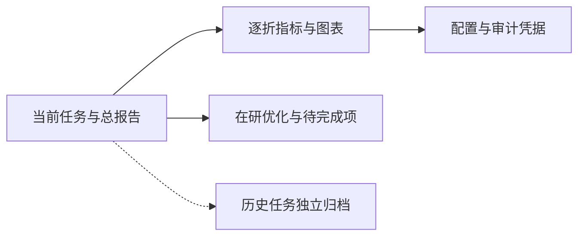

# 中文文档导航

_更新于 2026-09-07 · 区分当前主结果、进行中实验与历史探索_

---

## 📍 阅读顺序

如果要让 Codex 继续在 Overleaf 写论文，先阅读[论文写作交接说明](PAPER_WRITING_HANDOFF.md)，记录使用的 commit，并按其中的结果与限制清单引用。

## 📊 当前 Joint-6 主结果

| 文档 | 用途 |
|---|---|
| [实验结果总报告](reports/实验结果总报告_最终.md) | 七种模型、35/35 folds、主要指标、训练成本和分析 |
| [五折模型对比](ECG_LFM_Joint6_CV_Comparison_Report.md) | 当前 LoRA、Partial FT 与传统模型对比 |
| [完整评价报告](ECG_LFM_Joint6_Evaluation_Report.md) | 六类 OvR、ACS/OMI 边缘化与 NSTE 子组 |
| [结果目录说明](../results/joint6_cv/README.md) | CSV、图表、修正 sidecar 与历史曲线的区别 |
| [原完整性审计](reports/实验完整性审计_20260905.md) | 2026-09-05 发布时快照；成本/曲线修订见下节 |

“最佳”目前指已完成 Joint-6 模型对比中的 Joint-6 Macro AUPRC 最优，不代表外部验证完成、所有单项均最优或 Joint-6 已严格优于双 Head。

## 🔄 当前优化与审计修订

- [分阶段优化报告](ECG_LFM_Joint6_Optimization_Report.md)：已完成报告修复；两个新学习率仅在 Fold0 inner-validation 筛选，发布时仍在训练。
- [验证记录](logs/Joint6_Optimization_Verification_20260907.txt)：38 项测试与 CUDA 核验。
- [机器可读凭据](../results/joint6_optimization_20260907/verification_summary.json)：修复范围及未完成项。
- [本次整理记录](reports/仓库整理记录_20260907.md)：发布范围、历史保留策略与修正说明。

不要将该阶段 inner-validation 的 AUPRC 与五折 outer mean ± std 放在同一排名中。全部后续阶段的启动条件见优化报告。

## 📚 历史方案与探索

以下文件保留原路径用于溯源，不是当前 Joint-6 的模型组成部分：

| 历史研究 | 报告 |
|---|---|
| corrected factorized 双 Head / Partial FT / LoRA / DoRA | [修正评估报告](ECG_LFM_corrected_evaluation_report.md) |
| 静态权重与 RDR | [自适应重加权报告](ECG_LFM_adaptive_weighting_experiment_report.md) |
| 多目标优化 | [MOO 报告](ECG_LFM_multi_objective_optimization_report.md) |
| Direct RL / R1-v2 / Cross-task RL | [Direct RL](ECG_LFM_direct_RL_post_training_report.md) · [R1-v2](ECG_LFM_R1_v2_stabilization_report.md) · [Cross-task](ECG_LFM_CrossTask_RL_v2_report.md) |
| Joint-7 / Joint-10 训练前标签门控 | [Joint-7](ECG_LFM_joint7_label_audit_no_go_report.md) · [Joint-10](ECG_LFM_Nature_Joint10_CV_Comparison_Report.md) |
| 旧 OMI/AMI 损失、特征消融 | [历史消融报告目录](reports/loss_feature_ablation/) |

旧任务、旧端点、pooled OOF 与严格 nested 结果不可直接互相替代；历史 NO-GO 结果保留，避免选择性汇报。

## 🔗 维护入口

[报告索引](reports/README.md) · [日志索引](logs/EXPERIMENT_LOG_INDEX.md) · [结果导航](../results/README.md) · [协作说明](../CONTRIBUTING.md) · [仓库清单](../REPOSITORY_MANIFEST.md) · [仓库首页](../README.md)
